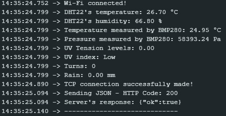

# MAIN SYSTEM

This file contains the code for the main system. To ensure proper operation, all required libraries must be installed as indicated in the [README](../../README.md), along with the ESP32 board installation in the Arduino IDE, also described in the same document.

After completing these steps, upload the code to the ESP32 while keeping it connected to your computer. Before uploading, make sure to update the fields corresponding to the Wi-Fi network name and password used by your computer. If these values do not match, the system will not function properly. These lines are:

```
const char* ssid = "wifi_name";
const char* password = "wifi_password";
```

Additionally, you must insert your computer’s IPv4 address in the following lines of the code:

```
if (!client.connect("IP_ADDRESS", 4000)) Serial.println("TCP connection to the server failed!");
...
http.begin("http://IP_ADDRESS:4000/data");
```

To find your IPv4 address, follow the instructions for your operating system:

### Windows

1. Press Win + R, type cmd, and press Enter;
2. In the Command Prompt, type:

```bash
ipconfig
```

3. Locate your active network interface (Wi-Fi or Ethernet) and look for the IPv4 Address field.

### Linux (Ubuntu, Debian, Fedora, etc.)

1. Open the Terminal;
2. Type one of the following commands:

```bash
ip addr show
```

or

```bash
ifconfig
```

3. Identify the active interface (typically wlan0, eth0, or similar) and look for the inet field, which contains the IPv4 address.

### macOS

1. Open the Terminal;
2. Type:

```bash
ifconfig
```

3. Locate the active interface (en0, en1, etc.) and look for the inet field corresponding to the IPv4 address.

---

With these adjustments, the system should run correctly. A sample of successful execution can be seen in the terminal screenshot below.



---