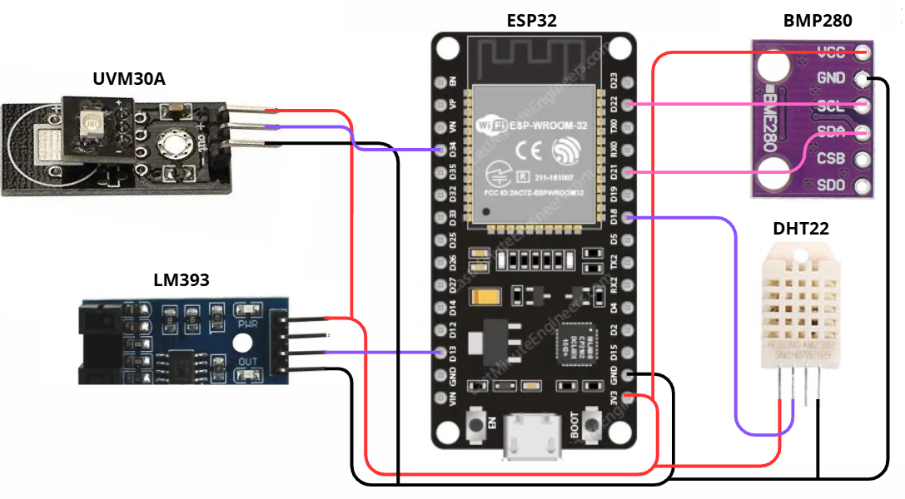

# SCHEMATIC

The circuit consists of the following components:

- ESP32 microcontroller
- DHT22 temperature and humidity sensor
- BMP280 atmospheric pressure sensor
- UVM30A ultraviolet radiation sensor
- LM393 encoder coupled to a rain gauge

The figure below shows the wiring diagram of all these components.

The VCC terminals of each sensor are connected to the ESP32’s +3.3 V output, and all GND terminals share the same ground line on the board. The DATA pin of the DHT22 is connected to GPIO 18. The SDA and SCL pins of the BMP280 are connected to GPIO 21 and GPIO 22, respectively. The output pin of the UVM30A sensor is connected to GPIO 34, and the digital output of the LM393 module is connected to GPIO 13.

With these connections, the circuit operates correctly according to the code provided in [System Code](../../software/main/main_system.ino).

---