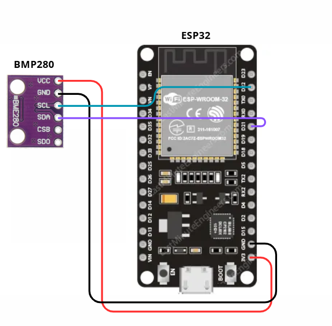
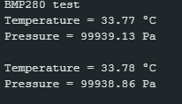

# PRESSURE AND TEMPERATURE SENSOR: BMP280

## Description

The BMP280 sensor measures temperature and atmospheric pressure, and it can also calculate altitude based on this data. It supports I2C or SPI communication, with I2C recommended for small projects. Its operating voltage ranges from 1.71V to 3.6V.

The datasheet is available here: [Datasheet BMP280 Sensor](https://cdn-shop.adafruit.com/datasheets/BST-BMP280-DS001-11.pdf).

## Measurement Range

- Measurements:
    - Temperature: -40 to +85°C;
    - Pressure: 300 to 1100 hPa.
- Resolution:  
    - Temperature: 0.01°C;
    - Pressure: 0.16 Pa.
- Accuracy:
    - Temperature: ±1°C;
    - Pressure: ±0.12 hPa.

## Pinout

The BMP280 sensor has 6 pins: VCC, GND, SCL, SDA, CSB, and SDO, in that order, as visible on the chip. When using I2C communication, the SCL and SDA pins are used in addition to power and connected to the corresponding I2C pins on the microcontroller. The connection used in this project can be seen in the image below.

Note: For the ESP32, an external pull-up resistor is usually not required for I2C lines, because the ESP32’s GPIO pins have internal pull-up resistors that can be enabled in software. However, in some cases or for longer I2C cables, adding an external pull-up (typically 4.7 kΩ to 10 kΩ) can improve signal stability.

## Programming

The BMP280 can be programmed in the Arduino IDE using the [Wire Library](https://docs.arduino.cc/language-reference/en/functions/communication/wire) (for I2C) and [DHT Sensor Library - Adafruit](https://github.com/adafruit/Adafruit_BMP280_Library). The sensor is initialized at address **0x77** or **0x76**.

The test code can be found here: [BMP280 Code](./bmp280.ino). A screenshot showing the sensor successfully operating with this code is provided below.

> [!WARNING]
> The **Wire.h** library uses pull-up resistors on the RX and TX pins. However, some BMP280 modules (such as the GY-BMP280) already include pull-up resistors. Pay attention to these details.

---