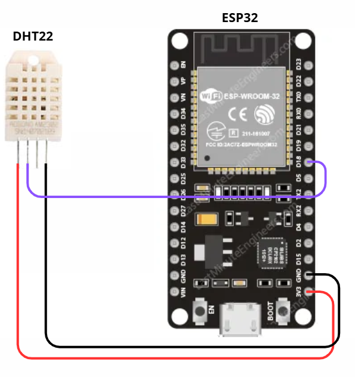
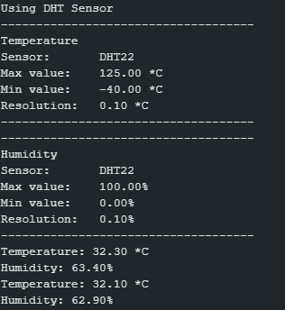

# HUMIDITY AND TEMPERATURE SENSOR: DHT22

### Description

The DHT22 sensor measures relative humidity and air temperature. It is a digital sensor with a 3.3V to 6V power supply and has 4 pins: VCC, DATA, NC, and GND, with the data pin requiring a pull-up resistor. It is recommended for applications that require higher accuracy and/or a wider measurement range. The response time (how long the sensor takes to react to changes) is ~2 seconds.

The DHT22 sensor datasheet can be found at: [Datasheet DHT22](https://www.alldatasheet.com/html-pdf/1132459/ETC2/DHT22/225/2/DHT22.html)

## Measurement Range

- Measurements:
    - Temperature: -40 to 80°C;
    - Humidity: 0 to 100%.
- Resolution:
    - Temperature: 0.1°C;
    - Humidity: 0.1%.
- Accuracy:
    - Temperature: ±0.5°C;
    - Humidity: ±2%.

### Pinout

The sensor has 4 pins: VCC, DATA, NC, GND (in this order). The data pin is a digital input of the microcontroller. The sensor connection used in this project can be seen in the image below. Due to the microcontroller used (ESP32), a pull-up resistor is not required, since all ESP pins have internal pull-up resistors.

## Programming

The BMP280 can be programmed in the Arduino IDE using the [Adafruit Sensor Library](https://github.com/adafruit/Adafruit_Sensor) and [DHT Sensor Library - Adafruit](https://github.com/adafruit/DHT-sensor-library).

The test code can be found here: [DHT22 Code](./dht22.ino) A screenshot showing the sensor successfully operating with this code is provided below.

---README.md