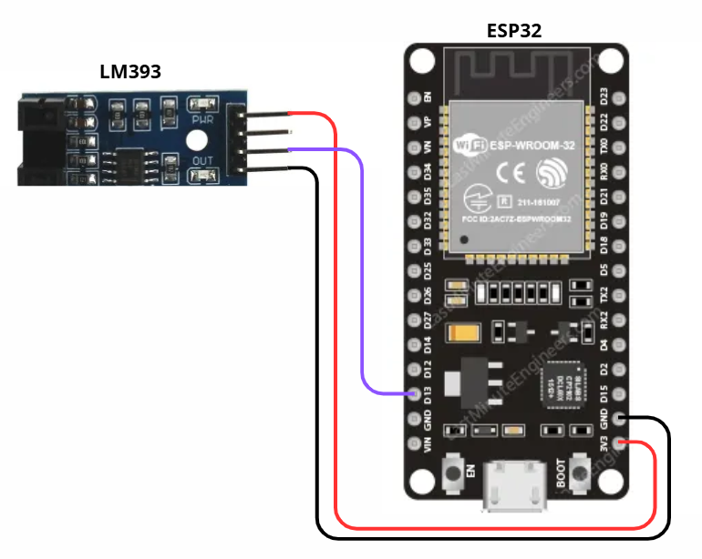
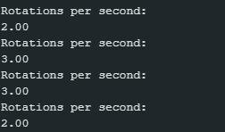

# ENCODER

### Description

An encoder is an electromechanical sensor used to convert mechanical motion (usually rotational motion of a shaft or linear displacement) into digital electrical signals that represent position, speed, and direction. It acts as a “translator” between physical movement and the electronic control system, allowing machines and controllers to know exactly how and where a component is moving. Encoders typically generate a square wave. They can be optical, magnetic, or mechanical, depending on how they detect motion.

There are two main types of encoders:

- Incremental Encoder: generates a sequence of pulses as the shaft rotates. Each pulse indicates a small increment of movement. Counting these pulses allows determination of speed and distance traveled, while the phase difference between two main signals (A and B), which are 90° out of phase, allows identification of the rotation direction: if signal A leads B, the shaft rotates in one direction; if B leads A, it rotates in the opposite direction. By counting the pulses of A (or B), the controller calculates how much the shaft has moved. If a Z pulse (index) is present, it marks the start of a full rotation, serving as a reference point to reset or synchronize the count.
- Absolute Encoder: provides a unique binary code for each shaft position. Thus, even if the system is turned off, upon power-on it “knows” immediately its position without requiring recalibration.

# SPEED SENSOR: LM393

### Description

The encoder speed sensor is an electronic device used to count the number of rotations of a shaft coupled to a motor. From this count, it is possible to determine the motor’s rotational speed and monitor motion variations accurately.

At the sensor’s tip, there is an infrared LED emitter and a phototransistor receiver, separated by a small gap through which the encoder disc passes. When the infrared light beam reaches the phototransistor, it conducts current; when the light is interrupted by the disc’s slots, conduction stops. This generates a voltage variation as the disc rotates, producing a sequence of pulses representing the motion.

However, these variations are analog signals that may contain noise and small fluctuations. Therefore, the module includes an integrated LM393 voltage comparator, which converts the phototransistor’s analog signal into a clean digital signal.

The LM393 compares the voltage from the phototransistor to an adjustable reference level. When the sensor voltage exceeds this threshold, the comparator changes the state of its output, producing a sharp digital pulse (0 or 1). Thus, each interruption of the light beam generates a square pulse that can be easily read by a microcontroller.

The faster the motor rotates, the more frequent the light interruptions, and consequently, the higher the frequency of the pulses generated by the LM393. This frequency is proportional to the motor’s rotational speed.

Additionally, the module has indicator LEDs that help visualize its operation, signaling power and pulse detection during operation.

### Pinagem

The pins are: VCC (3.3–5 V), GND, D0 (digital sensor output), and A0 (analog sensor output). The connection used in this project can be seen in the figure below.

### Programação

Programming is simple: just read the digital pin and work on it.

The test code can be seen here: [Encoder Code](./encoder.ino). A screenshot showing the sensor successfully operating with this code is provided below.

---