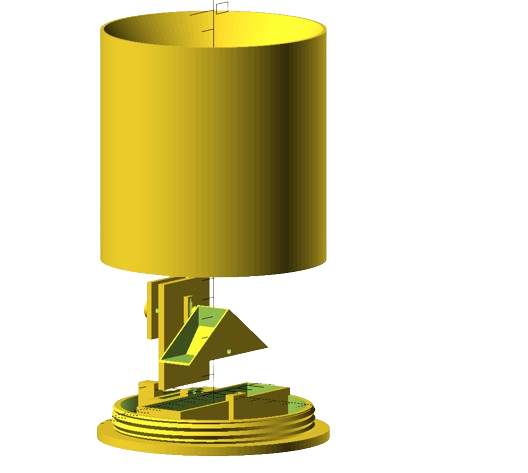
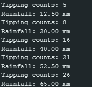

# PLUVIOMETER

## Description

A rain gauge is a sensor that measures the amount of rainfall over a specific area during a given period of time. It can be mechanical (such as a tipping cup that rotates when filled) or electronic (using sensors that detect individual drops or accumulated volume).

For use with the ESP, a rain gauge is coupled with an encoder ([LM393](../encoder/README.md)). Each time the rain gauge’s tipping cup rotates, the encoder generates digital pulses corresponding to a specific volume of rainfall. These pulses are then converted into millimeters of precipitation using the sensor’s calibration.

The rain gauge used in this project was 3D-printed, and its design can be seen in the figure below.

Image credits: [Pluviometer](https://github.com/cyberdebb/estacao_meteorologica/tree/main/sensores/Pluviometro)

## Programming

The rain gauge is coupled with an encoder, so the code is designed to read encoder pulses and calculate the volume of precipitation in milliliters. The test code can be found here: [Pluviometer Code](./pluviometer.ino). A screenshot showing the sensor successfully operating with this code is provided below.

---