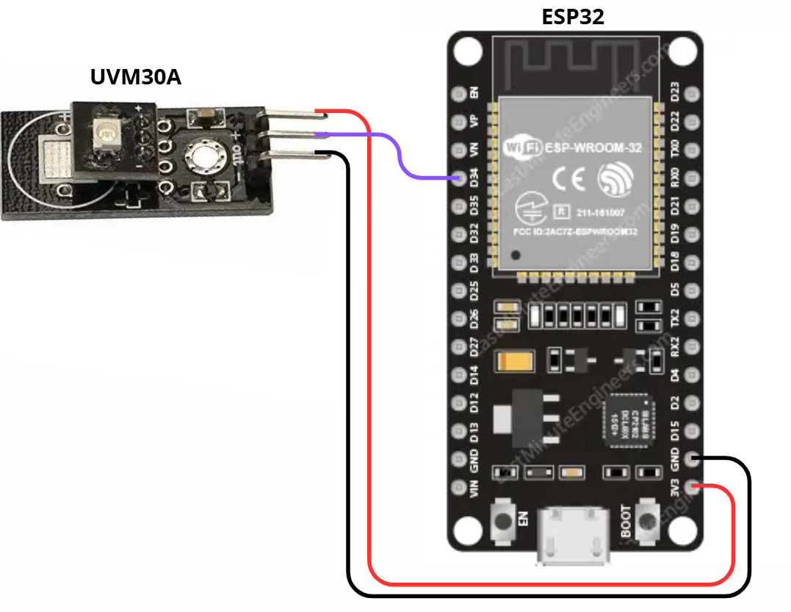
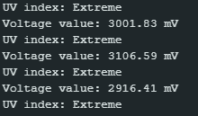

# ULTRAVIOLET RADIATION SENSOR: UVM-30A

### Description

The UVM-30A is an analog sensor designed to measure ultraviolet (UV) radiation intensity in the environment. It is capable of detecting UV-A, UV-B, and UV-C, and provides an output voltage proportional to the radiation intensity. The sensor operates in a range of 0 to 3.3 V.

The voltage reading can be interpreted as UV radiation levels according to the table below, taken from the following source: [Arduino Sensor Ultra Violet. Model: UVM-30A](https://curtocircuito.com.br/datasheet/sensor/raios_ultravioleta.pdf)

| **Voltage (mV)** | **UV level** |
|------------------|--------------|
| <50              | 0            |
| 227              | 1            |
| 318              | 2            |
| 408              | 3            |
| 503              | 4            |
| 606              | 5            |
| 696              | 6            |
| 795              | 7            |
| 881              | 8            |
| 976              | 9            |
| 1079             | 10           |
| 1170             | +11          |

The classification of UV radiation levels follows the standard established by the World Health Organization (WHO), in this link: [Radiation: The ultraviolet (UV) index](https://www.who.int/news-room/questions-and-answers/item/radiation-the-ultraviolet-(uv)-index). According to this guideline, UV index levels are categorized as shown in the table below.

| **UV level** | **Classification** |
|--------------|--------------------|
| 1, 2         | Low                |
| 3, 4, 5      | Medium             |
| 6, 7         | High               |
| 8, 9, 10     | Very High          |
| +11          | Extreme            |

---

### Measurement Range

To convert the microcontroller’s ADC reading to voltage, use the formula:

`sensor_value (V) = (adc_value / 4095) * Vref`

Where:

- **sensor_value:** voltage measured by the sensor (in V or mV)
- **adc_value:** value read from the microcontroller’s ADC (0–4095 on the ESP32)
- **4095:** maximum value of a 12-bit ADC (2¹² − 1)
- **Vref:** ADC reference voltage (in V, usually 3.3 V on the ESP32)

This voltage can then be mapped to the corresponding UV level using the table above.

### Pinout

The sensor has 3 clearly identified pins: VCC (Power supply, 3.3–5 V), OUT (Analog output proportional to UV radiation), and GND. The OUT pin should be connected to an ADC pin of the microcontroller. The connection used in this project can be seen in the figure below.

.

### Programming

Programming is simple: just read the analog pin using **analogRead()** (ESP32 or Arduino) and apply the ADC-to-voltage conversion as explained above.

The test code can be found here: [UVM-30A Code](./uvm30a.ino). A screenshot showing the sensor successfully operating with this code is provided below.

---
